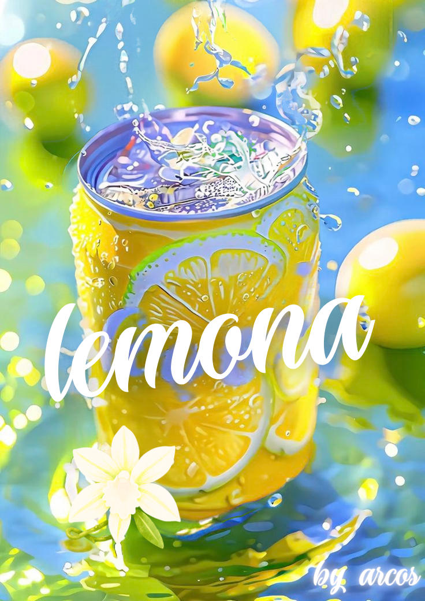

<div align="center">



# 🍋 L E M O N A

### *When life gives you lemons, we give life a little fizz.*

**A fictional soda brand born from Pinterest scrolling, Canva clicking, and an unreasonable amount of creative enthusiasm.**

<br>

[🍹 VISIT THE WEBSITE](https://projectlemona.netlify.app/)

<br>


</div>

---

## 🍋 Okay, But What Is Lemona?

Imagine you're peacefully scrolling through Pinterest.

One minute, you're looking at pretty pictures.

The next minute, you've decided that the world desperately needs another soda brand.

**And just like that, Lemona was born.**

Lemona is a fictional soda brand and a little creative experiment in branding, product design, and website building.

No factories.
No investors.
No refrigerators full of unsold soda.

Just an idea, a product design, a website, and the dangerous power of saying:

*"Wait... what if I actually made this?"*

## 🧪 The Extremely Scientific Origin Story

Every great brand starts somewhere.

Some start in garages. Some start in university dorm rooms.

Lemona started somewhere arguably more powerful: **the intersection of Pinterest inspiration and creative procrastination.**

Here's how the citrus chaos unfolded:

**🍋 Phase 01 — The Pinterest Rabbit Hole**

It started with visual inspiration. Colors, packaging, aesthetics, and all those little details that make a product look like it belongs on a supermarket shelf.

*Research? Technically.*

*Scrolling for longer than intended? Absolutely.*

**🎨 Phase 02 — Canva Entered the Chat**

An idea needed a face, so Canva got involved.

The fictional product started taking shape, slowly transforming from a random thought into something that looked suspiciously like an actual beverage brand.

Suddenly, this wasn't just an idea anymore.

It had branding.

It had a look.

It had absolutely no business plan.

**✨ Phase 03 — Google Stitch Did Its Thing**

A product deserves a website, obviously.

So Google Stitch entered the creative workflow to help turn the brand concept into a website design.

Because apparently, designing an imaginary soda wasn't enough. We also needed to give it an imaginary digital empire.

**💻 Phase 04 — From Design to Website**

The website came together in HTML, bringing the fictional brand to life on the internet.

And then came the most important milestone of all:

It went live.

Somewhere on the internet, Lemona now exists.

Technically, you can visit it.

Commercially, please don't ask for a delivery estimate.

---

## 🥤 Meet the Product

<div align="center">


### THE LEMONA EXPERIENCE™

*100% fictional. 1000% citrus-coded.*

</div>

A product concept designed to explore how visual identity and packaging can turn a simple idea into something that feels like a real brand.

Is it refreshing?

We have no laboratory results.

Does the packaging look cool?

That's between you and your eyeballs.

Can it be ordered?

Not unless you've discovered a way to purchase pixels.

---

## 🌐 Take a Sip of the Website

<div align="center">

### [🍋 ENTER THE WORLD OF LEMONA →](https://projectlemona.netlify.app/)

*One click. Zero calories burned.*

</div>

The website is the digital home of this fictional brand concept.

It brings together the visual direction, product presentation, and web design into one little internet experiment.

Go on. Have a look.

The lemons aren't going to click themselves.

---

## 🛠️ The Creative Recipe

| Ingredient           | What it brought to the party                  |
| -------------------- | --------------------------------------------  |
| 📌 Pinterest         | Visual inspiration and aesthetic exploration |
| 🎨 Canva             | Product design and brand visuals             |
| ✨ Google Stitch      | AI-assisted website design                  |
| 💻 HTML              | Bringing the website to life                 |
| 🚀 Netlify           | Getting Lemona onto the internet             |
| 🧠 Human imagination | The original questionable decision           |

**The recipe:** Take one idea, add some inspiration, stir in design, pour into HTML, and serve on the internet.

Best enjoyed with a cold drink and absolutely no expectation of profitability.

---

## 📂 Inside the Little Lemon Universe

```text
project_lemona/
│
├── index.html    # The digital lemonade stand
├── lemona.png    # The star of the show 🍋
└── screen.png    # The preview
└── readme.md     # You are reading it!

```

Simple ingredients. One refreshing result.

*If your HTML file is still named `code.html`, rename it to `index.html` for the structure shown above.*

---

## 💭 Why Make Something Like This?

Not every creative project needs to solve world hunger, train a neural network, or become a startup valued at several billion dollars.

Sometimes, you just want to experiment.

Lemona was an opportunity to explore:

* **Branding:** Giving a fictional product its own visual identity.
* **Product design:** Experimenting with how packaging can communicate a brand.
* **AI-assisted creativity:** Using modern design tools to accelerate the creative process.
* **Web development:** Turning a visual concept into a real, accessible website.
* **Creative storytelling:** Making the whole thing feel like more than just an HTML file.

The bigger idea?

**You don't always need a business idea to build something that feels like a business.**

Sometimes you just need curiosity, a little imagination, and a suspicious amount of lemon-themed enthusiasm.

---

## ⚠️ A Tiny but Important Disclaimer

Lemona is a fictional brand created for fun, design experimentation, and creative exploration.

This repository showcases a concept, not a commercially available beverage.

No actual soda is being sold here. No nutritional claims are being made. No lemons were harmed in the making of this README.

Please don't attempt to invest in Lemona.

We haven't even figured out where to store the lemons.

---

<div align="center">

## 🍋 THAT'S A WRAP!

### Stay zesty. Stay curious. Stay a little fizzy.

**Made with 💛, creative tools, and questionable levels of enthusiasm.**

[VISIT LEMONA](https://projectlemona.netlify.app/)

*Lemona — A fictional soda brand with very real creative energy.*

</div>
